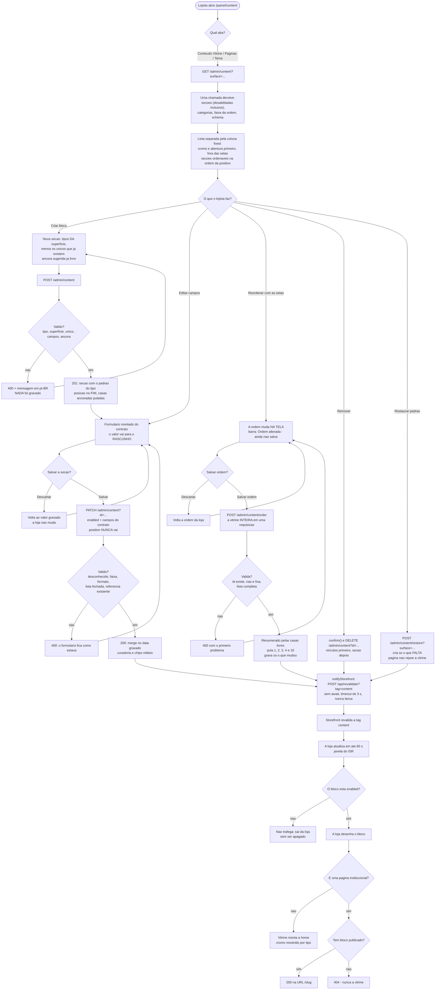

# 16 — Requisitos do Painel (Admin / CRM)

> **Documentação de Requisitos do Painel Administrativo.** Antes chamado
> `DOCUMENTACAO_REQUISITOS_ADMIN.md`, na raiz — passou a ser o **doc 16** em 13/10/2026.

> **O que este documento é.** Engenharia reversa do painel administrativo da Real Valor: o que o
> painel **permite**, o que ele **recusa**, o que **grava** e o que a loja **desenha** depois da
> gravação. Nada aqui foi inventado a partir de intenção: cada regra tem um `arquivo:linha` no
> repositório como evidência, e a evidência está listada em cada requisito.
>
> **Estado verificado em:** 12/10/2026, sobre o commit `487ccbc801`
> (`feat: ajuste na criação de seção das páginas em admin`).
>
> **Fonte da verdade.** O comportamento foi lido do código, nesta ordem de autoridade:
>
> 1. o **schema gravado no Postgres** (`content_schema`) é quem diz o que o painel desenha e o que a
>    API aceita — o `contract.ts` é *bootstrap*, usado quando a linha não existe ou está vazia
>    (`backend/src/modules/content/service.ts:87-93`, `packages/contrato/src/schema.ts:11-14`);
> 2. o **contrato** (`packages/contrato/src/contract.ts`) declara tipos, campos, faixas, superfícies e
>    as listas que as duas pontas leem;
> 3. as **rotas do backend** (`backend/src/api/admin/content/**`) aplicam as regras;
> 4. o **painel** (`admin/src/admin/routes/content/**`) é a interface — ele oferece, o servidor decide.

**Convenções de identificação.**

| Prefixo | Significado |
| :--- | :--- |
| `RF-ADM-nn` | Requisito funcional do painel administrativo |
| `RN-ADM-nn` | Requisito não funcional (integridade, segurança, cache, limite) |
| `UC-ADM-nn` | Caso de uso do painel |
| `A-n` | Fluxo alternativo (exceção) de um caso de uso |
| *Referência* | Requisito de negócio já existente neste repositório (`docs/real-valor/04-*`, `05-*`): `RV-0nn` (funcional) e `5.x` (seção não funcional) |

Este documento **não substitui** `docs/real-valor/04-requisitos-funcionais.md` nem
`docs/real-valor/05-requisitos-nao-funcionais.md`; ele os **mapeia** para o subsistema do painel.
Onde o requisito de negócio já existia, a coluna *Referência* aponta para ele em vez de criar um
código novo.

---

## 1. Atores e Escopo

### 1.1 Atores

| Ator | Tipo | O que faz | Evidência |
| :--- | :--- | :--- | :--- |
| **Lojista (operador do painel)** | humano, autenticado | Edita o conteúdo da vitrine, das páginas e do tema; publica a ordem; cria e remove blocos; restaura o padrão; envia imagem/PDF; cadastra rastreio de envio; enriquece o cadastro de uma peça | `admin/src/admin/routes/content/page.tsx:139-142` (rota "Conteúdo da vitrine"), `routes/shipping/page.tsx:310-313` ("Envios"), `widgets/product-enrichment.tsx:312-318` (widget da peça) |
| **Visitante / cliente** | humano, anônimo | Consome o resultado: a loja desenha o que o lojista gravou, ou responde 404 | `frontend/src/app/[countryCode]/(main)/page.tsx`; `(main)/[slug]/page.tsx:85-104` |
| **Storefront (Next.js)** | sistema | Lê o conteúdo por `GET /store/content?surface=`, com cache na tag `content` e janela de 60 s | `frontend/src/lib/data/content.ts:55-78`; `lib/content/cache.ts:22,25` |
| **Backend Medusa (Admin API)** | sistema | Autoriza a escrita, valida contra o schema gravado, grava e avisa o storefront | `backend/src/api/admin/content/route.ts`; `api/admin/content/{order,restore,pages}/route.ts` |
| **Contrato de conteúdo (`@rv/contrato`)** | sistema (código) | Declara tipos, campos, superfícies, casas fixas, estados de página e destinos — o *bootstrap* do schema | `packages/contrato/src/contract.ts`; `packages/contrato/src/schema.ts` |
| **Schema no Postgres (`content_schema`)** | dado | É o **registro** contra o qual a API valida e a partir do qual o painel desenha o formulário | `modules/content/service.ts:87-93`; `api/admin/content/route.ts:97-118` (`schemaSource`) |
| **Provider de arquivos (`@medusajs/file-local`)** | sistema | Recebe o upload e devolve a **chave** do arquivo (`1699999999-hero.jpg`) — que é o que o conteúdo grava | `content/components/image-input.tsx:82-102`; `content/components/document-input.tsx:74-93` |
| **CI / hook de commit** | sistema | Reprova o que o compilador não vê: artefato gerado velho e o painel importando **valor** do backend | `scripts/check-boundaries.mjs:1-30`; `Makefile:353-355`; `.github/workflows/check.yml:13-40,62-70` |

> **Sobre a autenticação.** O painel usa a autenticação nativa do Medusa (sessão por cookie): o painel
> é servido pelo próprio backend, e é por isso que as chamadas do CRM são `fetch` relativo com
> `credentials: "include"` (`content/components/image-input.tsx:80-86`). Este subsistema **não** tem esquema
> próprio de papéis/permissões — limitação registrada em `RN-ADM-14`.

### 1.2 Escopo

**Dentro do escopo:**

1. **Conteúdo da vitrine (`home`)** — as seções que montam a página inicial.
2. **Páginas institucionais (6 superfícies `kind: "page"`)** — `/sobre`, `/trocas-e-devolucoes`,
   `/privacidade`, `/termos`, `/contato`, `/perguntas-frequentes`.
3. **Tema da loja (`theme`)** — paleta e fontes, incluindo as estações sazonais com janela de datas.
4. **Ordenação e restauração** — "Salvar ordem" e "Restaurar padrão".
5. **Uploads de conteúdo** — imagem (até 8 MiB) e documento PDF (até 25 MiB).
6. **Índice de páginas** — o estado "no ar / fora do ar / sem blocos".
7. **Painel de envio (RV-043)** — o registro de rastreio, outra ponta de `GET /store/orders/track`.
8. **Widget de enriquecimento da peça** — cuidados, contraindicações, guia de medidas e o hex da cor
   de cada variante.

**Fora do escopo (explicitamente não coberto):**

| Fora de escopo | Por quê, e onde vive |
| :--- | :--- |
| Catálogo: produtos, categorias, coleções, preços, estoque | É o painel nativo do Medusa; o conteúdo apenas **referencia** categorias e produtos (`filters`, `productIds`) |
| Pedidos, pagamentos, reembolsos | Painel nativo do Medusa; o bloco de pedido/envio é o `RV-042` |
| Configuração de frete/transportadora | `RV-006` (provider `tabela`) e `RV-046` (bloqueado por decisão comercial) |
| Contas de cliente e checkout | Painel/loja nativos |
| E-mail transacional | `RV-045` |
| **Criação e publicação de páginas** | A tela **não cria** página (é a entidade `content_page` da estratégia B, que segue com gatilho) e **não publica/despublica a página inteira**: publica **por bloco** (`content/components/pages-view.tsx:24-27`) |
| Layout e componentes do storefront | `frontend/src/modules/content/`, `frontend/src/lib/content/` |
| Regras comerciais (preço, prazo, política) | `docs/real-valor/04-*` |

### 1.3 As superfícies do conteúdo

O contrato declara **8 superfícies** (`packages/contrato/src/contract.ts:2102-2250`), e cada uma sabe se
descrever para o painel — rótulo, campo de título, rótulo do interruptor, como a linha se chama no
singular, o aviso da aba, os tipos que aceita e a faixa da numeração (`contract.ts:2057-2100`).

| `id` | `kind` | Rótulo no painel | Tipos que aceita | Numeração (`order`) | Aviso da aba |
| :--- | :--- | :--- | :--- | :--- | :--- |
| `home` | `home` | Conteúdo da vitrine | Todos os 13 de `SECTION_TYPES` | `first: 5`, `step: 1` — pulando as casas 1, 2, 3, 4 e 10 | "Estas seções montam a página inicial, na ordem das setas…" (`contract.ts:2110-2121`) |
| `theme` | `theme` | Tema da loja | **Só** `theme` (uma estação por linha) | `first: 10`, `step: 10` — sem casa fixa | "Cada linha é uma estação, e a loja escolhe sozinha pelo dia de hoje…" (`contract.ts:2130-2136`) |
| `sobre` | `page` | Sobre | `PAGE_SECTION_TYPES` (8 tipos) | `first: 1`, `step: 1` | Monta o `/sobre`; sem bloco publicado → 404 (`contract.ts:2167-2180`) |
| `trocas-e-devolucoes` | `page` | Trocas e devoluções | `PAGE_SECTION_TYPES` | `first: 1`, `step: 1` | idem (`contract.ts:2181-2194`) |
| `privacidade` | `page` | Privacidade | `PAGE_SECTION_TYPES` | `first: 1`, `step: 1` | idem (`contract.ts:2195-2208`) |
| `termos` | `page` | Termos de uso | `PAGE_SECTION_TYPES` | `first: 1`, `step: 1` | idem (`contract.ts:2209-2221`) |
| `contato` | `page` | Contato | `PAGE_SECTION_TYPES` | `first: 1`, `step: 1` | idem (`contract.ts:2222-2235`) |
| `perguntas-frequentes` | `page` | Perguntas frequentes | `PAGE_SECTION_TYPES` | `first: 1`, `step: 1` | idem (`contract.ts:2236-2249`) |

**Tipos de seção (`SECTION_TYPES`, 13)** — na ordem do seletor do painel (`contract.ts:645-683`):

`announcement` · `hero` · `benefits` · `launches` · `collections` · `editorial` · `banner` ·
`prose` · `faq` · `featured` · `instagram` · `nav` · `footer`

**Tipos únicos por superfície (`SINGLETON_SECTION_TYPES`, 5)** —
`announcement`, `nav`, `hero`, `benefits`, `footer` (`contract.ts:722-728`).

**Tipos que uma página pode receber (`PAGE_SECTION_TYPES`, 8)** — a fatia de `SECTION_TYPES` que
**não** é única: `launches`, `collections`, `editorial`, `banner`, `prose`, `faq`, `featured`,
`instagram` (`contract.ts:2026-2028`). É derivada, nunca digitada: se um singleton novo nascer no
contrato, ele sai das páginas sozinho.

### 1.4 As telas do painel

| Rota no painel | Rótulo / ícone | O que é | Evidência |
| :--- | :--- | :--- | :--- |
| `/painel/content` | "Conteúdo da vitrine" · `SquaresPlus` | Tela de conteúdo, com **três abas**: `Conteúdo Vitrine`, `Páginas Institucionais`, `Tema da Loja` | `content/page.tsx:12-21,135-139`; `content/lib/navigation.ts:22-26` |
| `/painel/shipping` | "Envios" · `HandTruck` | Fila de envio: pedidos pagos e ainda não despachados, mais antigos primeiro | `routes/shipping/page.tsx:1-20,310-313` |
| — (widget) | `product.details.after`, id `real-valor:informacoes-da-peca` | Enriquecimento da peça, **dentro** do formulário do produto | `widgets/product-enrichment.tsx:1-35,312-318` |

> A URL do painel é derivada do caminho do arquivo, e o prefixo `/painel` é **configuração**
> (`MEDUSA_ADMIN_PATH`) — o CRM nunca escreve essa URL, só endereços de **API** (absolutos,
> `/admin/...`). É por isso que o atalho "Editar blocos" troca de **aba** em vez de navegar
> (`content/components/pages-view.tsx:10-15`; `content/page.tsx:39-48`).

---

## 2. Regras de Negócio (o que pode e o que não pode)

### 2.1 O que o lojista **pode**

| # | Regra de negócio | Evidência |
| :--- | :--- | :--- |
| B1 | **Pode criar** um bloco novo numa superfície, escolhendo o tipo e a âncora. A lista de tipos é a **da superfície** (a vitrine oferece seções, o tema oferece estações, a página oferece os 8 tipos de página), e os únicos que já existem **saem da lista** | `content/components/SectionCreator.tsx:10-13,43`; `content/lib/utils.ts:131-149` |
| B2 | **Pode pré-visualizar o numeral** de cada seção e **reordenar** a vitrine com as setas — mas a ordem só vale na loja depois de "Salvar ordem" | `content/OrderDirtyBar.tsx:1-8,19-27`; `content/hooks/useSurfaceSections.ts:399-417` |
| B3 | **Pode editar tudo em rascunho** e gravar quando quiser: enquanto não salvar, **a loja continua mostrando o conteúdo anterior** | `content/SectionRow.tsx:181-215`; `hooks/useSurfaceSections.ts:220-234` |
| B4 | **Pode remover** uma seção, com confirmação. Não há desfazer: recriar não devolve o conteúdo (a seção nova nasce com o padrão do tipo) | `hooks/useSurfaceSections.ts:290-303` |
| B5 | **Pode "Restaurar padrão"** a qualquer momento: só o que **falta** é criado — nada é apagado nem sobrescrito (operação idempotente) | `hooks/useSurfaceSections.ts:351`; `backend/src/modules/content/restore.ts:11-14,166-190` |
| B6 | **Pode ligar/desligar um bloco** por um interruptor ("Visível na loja" / "Estação no ar" / "Publicada"), sem apagar o conteúdo dele | `content/SectionRow.tsx:232-242`; `contract.ts:2108,2128,2171` |
| B7 | **Pode enviar imagem** (até **8 MiB**) e **documento PDF** (até **25 MiB**) pelo botão de envio, ou digitar à mão um caminho do site (`/brand/hero.jpg`) ou uma URL | `content/components/image-input.tsx:35,64-72,125-133`; `content/components/document-input.tsx:40,43,56-64` |
| B8 | **Pode escolher o destino de um link** numa lista das rotas que a loja tem (sugestão), **sem ficar preso** a ela: `https://…`, `mailto:`, `tel:` e a âncora `/#editorial` continuam valendo | `content/components/href-input.tsx:1-20,44-71`; `contract.ts:2321-2327` |
| B9 | **Pode aplicar aparência por seção** (fonte/cor de títulos, textos, detalhes e fundo) e **devolver um trilho ao padrão** com um clique, sem desfazer os outros trilhos | `content/SectionRow.tsx:78-89`; `contract.ts:976-996` |
| B10 | **Pode montar as estações sazonais** declarando uma janela `MM-DD` (sem ano). Cor ou fonte em branco é **herdada** do tema padrão | `contract.ts:2538-2541,2552-2563` |
| B11 | **Pode cadastrar o rastreio** de um envio (fila dos pedidos pagos, mais antigo primeiro) — e é isso que a cliente vê em `/rastreio` | `routes/shipping/page.tsx:1-20`; `backend/src/api/admin/shipping/route.ts:1-18` |
| B12 | **Pode enriquecer a peça** com cuidados, contraindicações, guia de medidas e o **hex** de cada variante — dado que o Medusa não tem campo para guardar | `widgets/product-enrichment.tsx:1-35` |
| B13 | **Pode ver o estado de cada página** ("Publicada", "Despublicada", "Sem blocos") com a contagem de blocos, e ir da linha para os blocos dela | `content/components/pages-view.tsx:86-158`; `contract.ts:2414-2436` |

### 2.2 O que o lojista **não pode** (e por quê)

| # | Não pode | Por quê | Como é recusado |
| :--- | :--- | :--- | :--- |
| N1 | **Criar um segundo bloco** de barra de anúncio, cabeçalho, capa, faixa de benefícios ou rodapé | O cromo é resolvido por `find` no layout, e a capa/faixa moram em **casa ancorada** (1, 2, 3, 4 e 10): o segundo bloco seria listado no CRM e **nunca** desenhado | O painel **não oferece** o tipo (`utils.ts:131-149`) e a API responde **400** (`route.ts:173-187`) |
| N2 | **Gravar `hero`, `benefits`, `announcement`, `nav` ou `footer` numa página** | São a abertura e o cromo da vitrine; numa página a loja não os desenha | **400** de `resolveSurface` (`validation.ts:285-293`) — e a página nem oferece o tipo |
| N3 | **Usar uma superfície que não existe** (`?surface=sobreo`) | Era 200 com lista vazia: o typo parecia uma página existente | **400** com a lista das superfícies declaradas (`validation.ts:305-313`), nas **duas** portas (CRM e loja) |
| N4 | **Gravar um campo que o tipo não declara** | O `data` guardaria algo que nenhum render lê, e o lojista leria "salvo" | **400** — `Campo desconhecido para "<type>": "<key>".` (`validation.ts:107-114`) |
| N5 | **Criar sem preencher os campos obrigatórios** | O bloco nasceria desenhável pela metade | **400** só no POST (`strict: true`): `Campo obrigatório ausente: "<name>".` (`route.ts:243-252`; `validation.ts:56-61,132-141`) |
| N6 | **Gravar número fora da faixa** do campo | A faixa vem do **campo** do contrato, e é a mesma que o `<input>` mostra | **400**: `não pode ser menor que 8` / `não pode ser maior que 60` (`validation.ts:143-160`; `contract.ts:1316-1321,1364-1369`) |
| N7 | **Gravar fora da lista fechada** num `select`/`color`/`font` | É a lista fechada que impede o texto livre de virar valor | **400**: `deve ser um de: …` (a opção vazia é escrita `(vazio = padrão do tema)`) (`validation.ts:49,162-176`) |
| N8 | **Gravar `hex` ou `MM-DD` fora do formato** | Um `#B9787` (5 dígitos) viraria variável CSS inválida e **sumiria sem erro** na loja | **400** pelo `pattern` do campo (`validation.ts:178-188`; `contract.ts:2519,2527`) |
| N9 | **Escolher âncora (`id`) malformada ou já usada** | O `id` é a chave da linha **e** o fragmento do menu (`/#hero`) | **400**: `^[a-z0-9][a-z0-9-]*$` e `Já existe uma seção com o id "<x>".` (`resolvers.ts:194-220`) |
| N10 | **Mandar referência a produto/categoria que não existe, repetida, ou que não é lista** | A tabela de link **não tem chave estrangeira** — o id inventado viraria um buraco silencioso na vitrine | **400**, para curadoria e chips, com a checagem em código (`resolvers.ts:16-21,44-110,112-157`) |
| N11 | **Gravar `position` que não é número** | `NaN` numa coluna `numeric` **não** dá erro no Postgres: quem quebra é a ordem da vitrine, sem nada acusar | **400**: `Campo "position" deve ser um número.` (`resolvers.ts:158-179`) |
| N12 | **Gravar ordem com id inexistente, com bloco fixo, ou com a lista incompleta** | Posição repetida = ordem indefinida (a loja ordena por `position ASC`); o fixo mora em casa ancorada; o que fica de fora manteria a posição antiga | **400** com as três mensagens de `orderErrors` (`backend/src/modules/content/order.ts:349-386`) |
| N13 | **Mover uma seção fixa** na lista | Fixo não tem ordem: a casa é dela | O painel não desenha as setas (`SurfaceSectionsPanel.tsx:125-129`), e a rota recusa a lista que traga fixo (`order.ts:363-370`) |
| N14 | **Editar uma seção que não existe** | Id de aba velha, ou digitado à mão | **404** `Seção não encontrada.` (`route.ts:321-329`) |
| N15 | **Escrever sem dizer qual seção** | A query é a identidade da escrita | **400** `Query param "id" é obrigatório.` (`route.ts:460-468`) |
| N16 | **Criar página nova, ou publicar/despublicar a página inteira** | A publicação é **por bloco**; a entidade `content_page` (estratégia B) segue com gatilho | Não existe porta para isso, e a tela declara o limite (`pages-view.tsx:24-27`) |
| N17 | **Esperar que o destino de um link seja conferido** | O servidor **não** valida `href`: a lista **sugere**, não tranca | `validateData` não toca em `href` (`href-input.tsx:37-38`); ver `RN-ADM-15` |
| N18 | **Esperar que o upload seja validado por tipo** | Quem escolhe o tipo é o **navegador** (`accept="image/*"`, `accept="application/pdf"`); um `curl` direto em `/admin/uploads` grava a chave do mesmo jeito | `document-input.tsx:22-28`; `image-input.tsx:136-150`; ver `RN-ADM-16` |

### 2.3 Fronteiras cinzentas (o que **diverge** entre as pontas — de propósito)

| Situação | O que uma ponta faz | O que a outra faz | Está correto? |
| :--- | :--- | :--- | :--- |
| **`position` no corpo** | O `curl` **pode** mandar (número). | O painel **nunca** manda: quem põe a seção nova no fim é o servidor, e quem manda na ordem é a lista | Sim — é a R6.5: a conta saiu do navegador (`route.ts:228-241`; `hooks/useSurfaceSections.ts:239-253`) |
| **Campo que sumiu do contrato mas segue no `data`** | A loja ignora; o CRM pode reenviá-lo | O formulário é montado **dos campos do contrato**, então o campo morto não vira "alteração" sozinho | Sim (`form-draft.ts:32-52`) |
| **Campo ausente num PATCH** | Mantém o valor gravado | O painel manda o formulário inteiro da seção | Sim (`validation.ts:56-61`; `hooks/useSurfaceSections.ts:246-253`) |
| **Curadoria ou chips com `[]`** | **Esvazia** (a lista manda) | Idem, e a resposta **relê** o que ficou gravado | Sim — `undefined` é "não mexe", `[]` é "esvazia" (`route.ts:421-441`) |
| **Registro de schema anterior (v < 15)** | Serve o formulário antigo: o campo degrada (ex.: `href` vira caixa de texto) | A API passa a **recusar como desconhecido** o campo/tipo que só existe no contrato novo | Sim — mas **exige `make seed-schema`** (`packages/contrato/src/schema.ts:38-75`; `Makefile:220-227`) |

---

## 3. Requisitos Técnicos

### 3.0 Modelo técnico em uma página

**O que existe no banco.** Uma seção é **uma linha** com colunas de controle — `id`, `surface`,
`type`, `enabled`, `position`, `fixed` — mais um `data` JSON com o que o tipo declara
(`backend/src/modules/content/payload.ts:1-10`). As **referências** (curadoria de produtos e chips de
categoria) **não** moram no `data`: são links do Medusa (`content_section_product`,
`content_section_category`), e por isso são lidas e escritas em passos próprios
(`payload.ts:18-32`; `modules/content/{curation,filters}.ts`).

**Como o corpo do painel é dividido.** O formulário manda um corpo **achatado**
(`{ enabled, position, headline, imageUrl, productIds, filters, … }`), e `splitPayload` diz para onde
cada chave vai — coluna, conteúdo ou referência — por uma lista fechada (`COLUMN_COERCIONS`:
`enabled`, `fixed`, `position`, `surface`), com `id` e `type` aceitos e ignorados (`payload.ts:63-77,
101-148`). Nenhum campo do contrato pode ter o nome de uma coluna — isso é conferido por teste
(`payload.ts:11-16`).

**Onde a numeração mora.** Tudo o que decide "que número esta seção recebe" mora em
`backend/src/modules/content/order.ts` — puro e testável —, e o painel recebe a **faixa** como dado
(`{ first, step, reserved }`) para **prever** o numeral sem importar a regra
(`order.ts:155-157`; `api/admin/content/route.ts:82-96`). O painel **nunca** calcula a posição final e
**nunca** a manda no `PATCH` (`hooks/useSurfaceSections.ts:239-253`).

### 3.1 Requisitos Funcionais (`RF-ADM-*`)

| ID | Requisito | Comportamento verificado | Rota / arquivo | Referência |
| :--- | :--- | :--- | :--- | :--- |
| **RF-ADM-01** | Listar os blocos de uma superfície | `GET /admin/content?surface=` devolve **todas** as seções (desabilitadas inclusive), já achatadas, **mais** curadoria, chips, catálogo de categorias, a faixa da ordem e o schema — a tela não pede o formulário em outra chamada | `api/admin/content/route.ts:49-119` | RV-014 (doc 14) |
| **RF-ADM-02** | Criar um bloco | `POST /admin/content`: valida `type` no **registro**, resolve a superfície, recusa o tipo que já existe quando é único, separa o corpo, confere as referências, monta o `data` (padrão do tipo **+** o que veio), calcula a posição de fim, valida (`strict`), resolve a âncora, grava a seção, **depois** curadoria e chips, avisa a loja e responde **201** | `api/admin/content/route.ts:123-282` | RV-014 |
| **RF-ADM-03** | Recusar um segundo bloco único | O(s) tipo(s) de `SINGLETON_SECTION_TYPES` que já existe(m) na superfície → **400** com mensagem que nomeia o rótulo do tipo no painel | `route.ts:173-187`; `contract.ts:722-728` | RV-014 |
| **RF-ADM-04** | Aceitar a âncora (`id`) opcional | Sem `id`, quem gera é o banco; com `id`, ele é respeitado — mas só no formato `^[a-z0-9][a-z0-9-]*$` e se estiver **livre**, senão **400** | `resolvers.ts:194-220`; `route.ts:254-260` | RV-014 |
| **RF-ADM-05** | Aplicar o conteúdo padrão na criação | A seção nasce com `DEFAULT_SECTION_DATA[type]` e o corpo por cima — é o que permite criar sem preencher os obrigatórios de uma seção que ainda não existe | `route.ts:213-215`; `modules/content/defaults.ts` | RV-014 |
| **RF-ADM-06** | Editar um bloco parcialmente | `PATCH /admin/content?id=`: `id` obrigatório, seção precisa existir (`404`), o `type` gravado precisa estar no registro (`500` se não), merge do `data` sobre o existente, `strict: false` (campo ausente mantém o valor) e **pode esvaziar uma chave de propósito** | `route.ts:305-419`; `validation.ts:56-61` | RV-014 |
| **RF-ADM-07** | Preservar curadoria e chips quando não vierem | `productIds`/`filters` **ausentes** = não mexe; **presentes** (mesmo `[]`) = a lista manda. A resposta **relê** o que ficou gravado | `route.ts:421-441`; `payload.ts:79-98` | RV-014 |
| **RF-ADM-08** | Alternar a visibilidade de um bloco | `enabled` é coluna; desligado, o bloco **não trafega** para a loja (`onlyEnabled: true` na leitura pública) e o CRM continua listando-o para reabilitar | `route.ts:56-59`; `api/store/content/route.ts:56-59`; `modules/content/service.ts:52-72` | RV-014 |
| **RF-ADM-09** | Remover um bloco | `DELETE /admin/content?id=`: apaga primeiro os **vínculos** (curadoria e chips, por seção) e depois a seção, e avisa a loja — nesta ordem, uma falha deixa a seção com a curadoria vazia, não uma seção apagada com lista ativa | `route.ts:450-488` | RV-014 |
| **RF-ADM-10** | Publicar a ordem de uma vez | `POST /admin/content/order` com `{ surface, ids }`: a lista **inteira** da vitrine na ordem da tela, **uma** requisição, **uma** gravação, **um** aviso; sem mudança de posição, **não** avisa a loja | `api/admin/content/order/route.ts:24-58`; `order.ts:408-436` | RV-014 |
| **RF-ADM-11** | Renumerar pulando as casas ancoradas | A renumeração escreve só o que **muda** e pula as casas de `FIXED_SECTION_POSITIONS` (na vitrine, 1, 2, 3, 4 e 10) — a sexta seção ordenável nasce em **11**, nunca em 10 | `order.ts:243-260,290-301`; `contract.ts:943-949` | RV-014 |
| **RF-ADM-12** | Recusar uma ordem inválida | Três checagens em estágios: id desconhecido / seção fixa na lista / lista incompleta → **400** com a mensagem do primeiro problema | `order.ts:312-332,349-386` | RV-014 |
| **RF-ADM-13** | Prever o numeral no painel | A faixa da superfície chega como **dado** (`order` no payload), e o painel calcula o numeral por `numeralFor` — a mesma conta que o servidor faz, pulando as casas ancoradas. Sem ordem pendente, mostra o numeral gravado | `content/lib/utils.ts:179-197`; `SurfaceSectionsPanel.tsx:131-139`; `order.ts:109-140` | RV-014 |
| **RF-ADM-14** | Restaurar o padrão da superfície | `POST /admin/content/restore?surface=`: cria **só o que falta** (idempotente), devolve `{ created, kept, chips }`; **201** quando criou algo ou repôs chips, **200** quando não havia nada a fazer | `api/admin/content/restore/route.ts:15-45`; `restore.ts:166-228` | RV-014 |
| **RF-ADM-15** | Não repor a vitrine dentro de uma página | `defaultsFor` escolhe pelo **`kind`** da superfície: página → `DEFAULT_PAGE_SECTIONS[surface] ?? []` (hoje vazio de propósito); tema → `THEME_SECTIONS`; resto → `DEFAULT_HOME_SECTIONS`. Página vazia não repõe nada — e página vazia responde 404 | `restore.ts:93-99`; `modules/content/defaults.ts` | RV-014 |
| **RF-ADM-16** | Posicionar a seção restaurada | A seção que volta entra na **primeira casa livre depois do vizinho** que ela tem no padrão (`positionAfter`); a fixa volta para a **casa ancorada** do tipo, e não "depois do vizinho" | `restore.ts:121-163`; `order.ts:216-231` | RV-014 |
| **RF-ADM-17** | Repor os chips padrão | Os chips são **referência** (link), então não viajam na linha criada: um segundo passo liga as categorias padrão nas seções que nasceram agora — e a resposta diz **quais** receberam chips | `restore.ts:16-22,213-222`; `modules/content/filters.ts` | RV-014 |
| **RF-ADM-18** | Enviar imagem e gravar a chave | O envio vai para `POST /admin/uploads` e o que se grava é a **chave** (`1699999999-hero.jpg`), nunca a URL absoluta — a URL tem o endereço de quem respondeu, e o conteúdo passaria a apontar para `localhost`. A prévia resolve a chave em `/static/<chave>` | `content/components/image-input.tsx:9-16,56-62,82-102,179-191` | RV-014 |
| **RF-ADM-19** | Enviar documento PDF e gravar a chave | Mesmo envio, mesma regra de valor (a **chave**); a loja **não desenha** o arquivo — publica um botão que baixa. O campo aceita caminho do site ou URL colada à mão | `content/components/document-input.tsx:1-28,74-93` | RV-014 |
| **RF-ADM-20** | Editar o tema e as estações | O bloco de tema usa a **mesma máquina** dos campos de seção: `label` obrigatório, `dateRangeStart`/`dateRangeEnd` em `MM-DD`, uma cor `hex` por token de paleta e uma fonte `select` por papel — tudo por campo do contrato, sem tela própria | `contract.ts:2543-2580`; `schema.ts:386,394` | RV-014 |
| **RF-ADM-21** | Mostrar o índice das páginas | `GET /admin/content/pages` devolve uma linha por página declarada com `blocks`, `published` e `state`, **mais** o vocabulário dos estados (rótulo, tom e frase). O estado é calculado no **servidor**, pela mesma régua que a loja aplica antes do 404 | `api/admin/content/pages/route.ts:34-55`; `modules/content/pages.ts:76-95`; `contract.ts:2445-2453` | RV-014 |
| **RF-ADM-22** | Desenhar o formulário a partir do contrato | O painel monta o formulário do que o **registro** diz: `schema.fields`, `typeLabels`, `itemFields`, `palette`, `fonts`, `darkTokens`, `markdownMarks`, `destinations`, `singletonTypes`, `surfaces`. Um tipo/campo novo no contrato aparece sem edição em React | `schema.ts:375-436`; `content/SectionRow.tsx:44-76` | RV-014 |
| **RF-ADM-23** | Agrupar aparência em trilhos | Os campos de aparência são declarados **em ordem**, no mesmo array, com `group` + `attachedTo`; o painel desenha o trilho **logo abaixo** do campo que ele veste, e há um botão por trilho para voltar ao padrão. O trilho de fundo escuro traz um aviso automático | `contract.ts:976-998,1232-1251`; `content/lib/utils.ts:59-130`; `content/SectionRow.tsx:78-89,217-230` | RV-014 |
| **RF-ADM-24** | Editar listas com ordem por setas | Os itens de uma lista (`slides`, `items`, `columns`, `links`…) são reordenáveis por setas, e o cabeçalho de cada item é um **resumo lido dos próprios campos dele** (a ordem do `ITEM_FIELDS`), não "Item 2" | `content/lib/list-order.ts:1-31`; `contract.ts:1792` (`ITEM_FIELDS`) | RV-014 |
| **RF-ADM-25** | Marca de texto formatado | O campo `markdown` grava **texto** (sem HTML) com um subconjunto fechado de marcas — negrito, itálico, riscado e link — oferecido por uma barra acima da caixa; o link entra já na forma segura e o `href` é allowlist no storefront | `contract.ts:1698-1707`; `content/markdown-bar.ts` | RV-014 |
| **RF-ADM-26** | Sugerir destinos de link | O campo `href` é texto com `datalist` alimentado por `schema.destinations` (rotas fixas da loja **+** as páginas declaradas, derivadas de `PAGE_SURFACES`); a lista **sugere**, não tranca | `content/components/href-input.tsx:22-71`; `contract.ts:2294-2327` | RV-014 |
| **RF-ADM-27** | Selecionar chips de categoria por **referência** | O campo `filters` é `list:category`: o catálogo vem do **banco** (não de uma lista do contrato), a tela mostra o nome atual da categoria e o corpo manda **ids**; nome e `handle` são lidos ao vivo na hora de desenhar | `api/admin/content/route.ts:64-81`; `content/form-draft.ts:97` (`wireValue`); `modules/content/filters.ts` | RV-014 |
| **RF-ADM-28** | Painel de envio (rastreio) | `GET /admin/shipping` lista pedidos pagos ainda não despachados (e os já despachados), **mais antigo primeiro**, com `metadata` cru; a gravação é por pedido (`/admin/shipping/[id]`) e a validação mora no **backend**, não na tela | `api/admin/shipping/route.ts:1-30`; `routes/shipping/page.tsx:18-27` | **RV-043** |
| **RF-ADM-29** | Enriquecer a peça | Um widget em `product.details.after` grava cuidados, contraindicações, guia de medidas e o hex de cada variante; a regra de gravação (**mescla, nunca substitui**; em branco apaga a chave) é função pura e testada | `widgets/product-enrichment.tsx:1-35`; `widgets/enriquecimento-form.tsx` | RV-009 |
| **RF-ADM-30** | Avisar o storefront depois de gravar | Toda porta que grava chama `notifyStorefront` **sem `await`**: `POST`, `PATCH`, `DELETE`, `/order` e `/restore`. Só `/order` deixa de avisar quando nada mudou de posição | `modules/content/revalidate.ts:38-40`; `route.ts:293,443,485`; `order/route.ts:52-57`; `restore/route.ts:33-36` | RV-014 / RV-007 |

### 3.2 Requisitos Não Funcionais (`RN-ADM-*`)

| ID | Requisito | Situação verificada | Evidência | Referência |
| :--- | :--- | :--- | :--- | :--- |
| **RN-ADM-01** | **Autorização** | O subsistema usa a **autenticação nativa** do Medusa (sessão por cookie). **Não há papéis/permissões próprios**: quem está autenticado no painel pode tudo no conteúdo. *Limitação registrada.* | `content/components/image-input.tsx:80-86`; `api/admin/**` (sem guard próprio) | 5.4 ("autorização de `/painel` — a verificar") |
| **RN-ADM-02** | **O registro é a fonte do schema** | A API valida e o painel desenha pelo **schema gravado**; o contrato é *bootstrap*. `GET` devolve `schemaSource` (`"db"` ou `"contract"`) para tornar visível que o registro ainda não foi semeado. Mudança de **formato** exige `make seed-schema`, e o `--check` do registro reprova o desatualizado | `modules/content/service.ts:74-93`; `schema.ts:355-365`; `api/admin/content/route.ts:100-118`; `Makefile:220-227`; `.github/workflows/check.yml:62-70,106-151` | RV-014 |
| **RN-ADM-03** | **Fronteira de código (painel × backend)** | O painel importa **tipo** do backend, nunca **valor** — inclusive pelo apelido `@conteudo/*`, lido do `tsconfig` do painel. Importar valor **compila** e volta em silêncio (foi assim que o `nextPosition` duplicado reapareceu); a guarda reprova no `make check` e no CI | `scripts/check-boundaries.mjs:1-30,95-111`; `Makefile:353-355`; `content/lib/utils.ts:16-23` | 5.5.3 (item 6) |
| **RN-ADM-04** | **Integridade transacional por operação** | Criar/editar grava a **seção** e, em seguida, **auxi­liares** (curadoria, chips) em chamadas separadas: **não há transação única** entre eles. A ordem escolhida faz a falha parcial deixar um estado *recuperável pela tela* (seção sem curadoria / sem chips), e a resposta só afirma o que de fato foi gravado | `route.ts:281-291,426-441,470-483`; `modules/content/curation.ts` | RV-014 |
| **RN-ADM-05** | **`position` única por superfície** | A loja ordena por `position ASC`; duas seções com o mesmo número têm ordem **indefinida**, e o lojista não consegue consertar digitando. Por isso: `NaN` é recusado em código e a renumeração **pula** as casas ancoradas | `modules/content/service.ts:52-72`; `resolvers.ts:158-179`; `order.ts:17-48,243-260` | RV-014 |
| **RN-ADM-06** | **A ordem pertence à lista, não ao formulário** | O `PATCH` de um texto **não** reescreve `position`; a ordem só muda por `POST /admin/content/order`, com a lista inteira — uma requisição, uma gravação, um aviso (era N `PATCH`es e uma ordem parcial em caso de falha) | `hooks/useSurfaceSections.ts:239-253,429-441`; `order/route.ts:1-18` | RV-014 |
| **RN-ADM-07** | **Cache/ISR da loja** | A leitura pública é `force-cache` com tag `content` e janela de **60 s**; a gravação dispara `POST {FRONTEND_URL}/api/revalidate?tag=content` com `x-revalidate-secret` — **best effort**: timeout de 3 s, **nunca lança**, e é **pulado** quando `FRONTEND_URL` ou `REVALIDATE_SECRET` não existem. Falha de aviso não desfaz a gravação | `frontend/src/lib/data/content.ts:55-78`; `frontend/src/lib/content/cache.ts:22,25`; `modules/content/revalidate.ts:38-121` | 5.3, RV-007 |
| **RN-ADM-08** | **Confiabilidade do aviso à loja** | A rota do conteúdo **não espera** o storefront (o `void` é intencional): a resposta do CRM não depende da loja estar no ar, ao custo de até 60 s de defasagem | `revalidate.ts:20,38-40,44-47` | RV-007 |
| **RN-ADM-09** | **Idempotência do "Restaurar padrão"** | Rodar duas vezes com tudo no lugar **não muda nada** (`{ created: [], kept: n }`), e rodar numa base vazia cria a lista inteira de uma vez (as posições planejadas contam como vizinhas) | `restore.ts:11-14,166-190`; `restore.ts:121-163` | RV-014 |
| **RN-ADM-10** | **Idioma** | Toda mensagem de erro da API e todo rótulo do painel são **pt-BR**, incluindo o vocabulário dos estados de página e as mensagens de validação | `validation.ts:107-192`; `contract.ts:2414-2436`; `content/lib/navigation.ts:22-26` | **RV-003** |
| **RN-ADM-11** | **Desempenho das leituras do painel** | Cada aba carrega **uma** superfície (uma chamada); o índice de páginas faz **uma consulta por página declarada** (6 hoje) em vez de uma consulta sem filtro — N+1 **conhecido e aceito**, porque passa pela fachada do módulo (`listSections`) e garante que o índice e a aba não discordem; o painel de envio limita a fila a **100 pedidos** | `modules/content/pages.ts:141-155`; `api/admin/shipping/route.ts:25-27` | 5.3 |
| **RN-ADM-12** | **Acessibilidade do painel** | O painel é desenhado sobre `@medusajs/ui` (Headless UI), com `aria-label` nos botões só de ícone (setas, remover) e `aria-hidden` nos ícones decorativos. **Não há auditoria de acessibilidade própria** deste subsistema, e o risco de contraste do botão primário (~3,4:1) é herdado do design system | `content/SectionRow.tsx:140-167`; `content/page.tsx:100` | 5.1 (todo) |
| **RN-ADM-13** | **Observabilidade** | A falha do aviso à loja **não é silenciosa**: entra no log do backend com a tag e a orientação ("a loja continua correta e se atualiza em até um minuto"). Não há métrica nem alerta — é log | `revalidate.ts:96-120` | 5.5.2 |
| **RN-ADM-14** | **Papéis e permissões** | **Inexistentes** neste subsistema: sem separação entre quem edita conteúdo e quem edita envio/enriquecimento; a única porta é a sessão do Medusa. *Limitação registrada — candidata a requisito novo.* | *(ausência verificada em `api/admin/**` e `admin/src/admin/**`)* | 5.4 |
| **RN-ADM-15** | **Destino de link (`href`) e XSS** | O servidor **não** valida `href` (é o defeito medido no doc 13: um `/stroe` digitado à mão vai ao ar). A mitigação está **na loja**: o `href` do texto formatado é **allowlist** no storefront — o que não passa sai como texto —, e o botão de link do editor insere a forma já segura (`](/rota)`) | `content/components/href-input.tsx:37-38`; `contract.ts:1702-1706` | 5.4 (risco 3), doc 13 |
| **RN-ADM-16** | **Uploads: limite, tipo e custo** | O teto é conferido **antes de subir**, no cliente: **8 MiB** (imagem) e **25 MiB** (PDF). O tipo é escolhido pelo **navegador** (`accept`) e **não** é conferido pelo servidor — um `curl` direto em `/admin/uploads` grava a chave de qualquer arquivo. O multipart é montado **em memória** no backend, logo o custo de um arquivo grande não é o arquivo, é o processo | `content/components/image-input.tsx:27-35,64-72`; `content/components/document-input.tsx:15-28,56-64`; `api/store/content/route.ts` (leitura) | 5.4 (risco 2), RV-014 (decisão 10 de 14.14) |
| **RN-ADM-17** | **Concorrência (duas abas)** | Duas abas podem editar a mesma seção: o último `PATCH` **vence** (merge sobre o `data` lido no momento da gravação), e não há `If-Match`/versão otimista. A **ordem** é imune por construção: a lista chega inteira e a renumeração é idempotente | `route.ts:412-419`; `order.ts:388-401` | — (não mapeado) |
| **RN-ADM-18** | **Versionamento e rollback do schema** | O `schemaVersion` é carimbado **na escrita** (não derivado do registro), e sobe quando o **formato** muda — hoje **v15**. `make check-schema` compara o registro com o contrato, em Postgres efêmero, no CI. Rollback é `make seed-schema` (reescreve a linha com a versão do código), e a loja **descarta** o que não reconhece em vez de quebrar a página | `packages/contrato/src/schema.ts:38-75,204,353-365`; `Makefile:225-227`; `.github/workflows/check.yml:62-70,106-151`; `frontend/src/lib/data/content.ts:19-27` | RV-014 |

### 3.3 Contrato de erro da API do conteúdo (mensagens literais)

Esta tabela é o **contrato observável** do subsistema: é o que a tela do lojista mostra no `toast`.
Todas as mensagens são pt-BR e vêm da camada que decide (nunca do banco).

| # | Gatilho | Status | Mensagem (literal) | Origem |
| :--- | :--- | :--- | :--- | :--- |
| E1 | `type` fora do registro (POST) | `400` | `Campo "type" deve ser um de: <lista do registro>.` | `route.ts:132-142` |
| E2 | Superfície não declarada | `400` | `Superfície de conteúdo desconhecida: "<x>". As declaradas são: <lista>.` | `validation.ts:305-313` |
| E3 | Superfície `theme` com `type` ≠ `theme` | `400` | `A superfície "theme" só aceita blocos de type "theme".` | `validation.ts:265-271` |
| E4 | Tipo não aceito pela superfície | `400` | `A superfície "<s>" não aceita blocos do tipo "<t>".` — ou, se o tipo for único: `O tipo "<t>" é único da vitrine: … Ele não existe em "<s>".` | `validation.ts:285-293` |
| E5 | Segundo bloco de um tipo único | `400` | `Já existe uma seção do tipo "<t>" em "<s>". Ele é único — é "<rótulo>", um bloco fixo da vitrine: edite a seção existente.` | `route.ts:173-187` |
| E6 | Chave que o tipo não declara | `400` | `Campo desconhecido para "<type>": "<key>".` | `validation.ts:107-114` |
| E7 | Obrigatório ausente (**só no POST**) | `400` | `Campo obrigatório ausente: "<name>".` | `validation.ts:132-141` |
| E8 | `number` não numérico | `400` | `Campo "<n>" deve ser número.` | `validation.ts:143-148` |
| E9 | Número fora da faixa do campo | `400` | `Campo "<n>" não pode ser menor que <min>.` / `não pode ser maior que <max>.` | `validation.ts:149-160` |
| E10 | Fora da lista fechada (`select`/`color`/`font`) | `400` | `Campo "<n>" deve ser um de: (vazio = padrão do tema), <opções…>.` | `validation.ts:162-176` |
| E11 | `hex`/`MM-DD` fora do `pattern` | `400` | `Campo "<n>" deve estar no formato esperado (<pattern>).` | `validation.ts:178-188` |
| E12 | `list:*` que não é lista | `400` | `Campo "<n>" deve ser uma lista.` | `validation.ts:190-192` |
| E13 | Tipo sem campos no schema gravado | `400` | `O tipo "<t>" não tem campos no schema gravado (backend/src/modules/content/schema.ts).` | `validation.ts:99-105` |
| E14 | Curadoria inválida / repetida / inexistente | `400` | `Campo "productIds" deve ser uma lista de ids de produto.` · `Campo "productIds" tem id repetido: a curadoria é uma lista ordenada, e cada produto aparece uma vez.` · `A curadoria aponta produto que não existe (ou foi removido): <ids>.` | `resolvers.ts:44-91` |
| E15 | Chips inválidos / repetidos / inexistentes | `400` | `Campo "filters" deve ser uma lista de ids de categoria.` · `…tem id repetido: os chips são uma lista ordenada…` · `Os filtros apontam categoria que não existe (ou foi removida): <ids>.` | `resolvers.ts:112-157` |
| E16 | `position` não numérica | `400` | `Campo "position" deve ser um número.` | `resolvers.ts:158-179` |
| E17 | `id` fora do formato de apelido | `400` | `Campo "id" deve ser um apelido em minúsculas, sem espaços (letras, números e hífen): ele vira a âncora do link, como "/#hero".` | `resolvers.ts:202-208` |
| E18 | `id` já em uso | `400` | `Já existe uma seção com o id "<x>".` | `resolvers.ts:215-217` |
| E19 | Sem `id` na query (PATCH/DELETE) | `400` | `Query param "id" é obrigatório.` | `route.ts:313-319,460-468` |
| E20 | Seção inexistente (PATCH) | `404` | `Seção não encontrada.` | `route.ts:321-329` |
| E21 | `type` inválido **gravado** na linha (PATCH) | `500` | `Seção "<id>" tem type inválido gravado: "<t>".` | `route.ts:331-339` |
| E22 | Corpo de ordem sem lista / repetida | `400` | `Campo "ids" deve ser uma lista de ids de seção.` / `Campo "ids" tem id repetido: a ordem é uma lista, e cada seção aparece uma vez.` | `order.ts:312-332` |
| E23 | Ordem com id desconhecido | `400` | `Os ids apontam seção que não existe (ou foi removida): <ids>.` | `order.ts:356-361` |
| E24 | Ordem trazendo seção fixa | `400` | `A ordem traz seção fixa (o cromo do site e a abertura da home), que mora numa casa ancorada e não é numerada: <ids>.` | `order.ts:363-370` |
| E25 | Ordem incompleta | `400` | `A lista não traz a vitrine inteira: falta <ids>. A renumeração escreve só o que veio, e o que ficou de fora manteria a posição antiga — que a lista nova pode estar ocupando.` | `order.ts:372-383` |

**Sucessos (o que a tela consome):**

| Porta | Status | Corpo |
| :--- | :--- | :--- |
| `POST /admin/content` | `201` | `{ section }` (com curadoria e chips quando o corpo os trouxe) |
| `PATCH /admin/content` | `200` | `{ section }` (curadoria relida; chips relidos sempre) |
| `DELETE /admin/content` | `200` | `{ id, object: "content_section", deleted: true }` |
| `POST /admin/content/order` | `200` | `{ updated: [{ id, position }] }` — vazio quando nada mudou |
| `POST /admin/content/restore` | `201` se criou algo ou repôs chips · `200` se não | `{ created, kept, chips }` |
| `GET /admin/content` | `200` | `{ sections, categories, order, schema, schemaVersion, schemaSource }` |
| `GET /admin/content/pages` | `200` | `{ pages, pageStates }` |

### 3.4 Matriz de capacidades por superfície

| Capacidade | `home` (vitrine) | `theme` (tema) | `page` (6 páginas) |
| :--- | :--- | :--- | :--- |
| **Criar bloco** | Sim — todos os 13 tipos | Sim — **só** `theme` (uma estação por linha) | Sim — os 8 de `PAGE_SECTION_TYPES` |
| **Bloco único (singleton)** | Sim — 5 tipos, um de cada | Não se aplica (cada estação é um bloco) | Nenhum (nenhum tipo de página é único) |
| **Casa ancorada** | 1, 2, 3, 4 e 10 — não se move | Nenhuma | Nenhuma |
| **Ordenar (setas + "Salvar ordem")** | Sim — só as **não fixas** | Sim — `first: 10`, `step: 10` | Sim — `first: 1`, `step: 1` |
| **Renumerar** | De 1 em 1, **pulando** 1-4 e 10 (5…9, 11) | De 10 em 10 | De 1 em 1 |
| **"Restaurar padrão"** | Repõe `DEFAULT_HOME_SECTIONS` | Repõe `THEME_SECTIONS` | Repõe `DEFAULT_PAGE_SECTIONS[id]` — hoje **vazio** (não repõe nada) |
| **Upload de imagem/PDF** | Campo a campo (`kind: "image"` / `"document"`) | Não | Campo a campo |
| **Interruptor** | "Visível na loja" | "Estação no ar" (janela de datas decide) | "Publicada" |
| **Nome da linha na lista** | Pelo **tipo** ("Sobre", "Coleções") | Pelo que o dono escreveu (`label`: "Natal") | Pelo tipo do bloco |
| **Efeito na loja** | Monta a página inicial; cromo resolvido por `find` | Paleta/fontes da loja inteira, escolhidas por **data** | Monta a URL `/<id>`; sem bloco publicado → **404** |

**A régua do 200/404 de uma página** (a mesma nos dois lados, por isso a tela vale):

| Estado | Estado na tela | O que significa | O que a loja faz |
| :--- | :--- | :--- | :--- |
| `published` | "Publicada" (verde) | Tem bloco **publicado**: o endereço responde | `200` |
| `unpublished` | "Despublicada" (laranja) | Tem blocos e **nenhum publicado** | `404` — "se o rodapé promete esta página, ele promete um link quebrado" |
| `empty` | "Sem blocos" (cinza) | Nenhum bloco montado | `404` — "até alguém montar a página" |

A régua é `publishedSections` + `pageState` (`contract.ts:2381,2445-2453`), aplicada **no servidor**
(`modules/content/pages.ts:76-95`) e **na loja** antes do `notFound()`
(`frontend/src/app/[countryCode]/(main)/[slug]/page.tsx:85-104`). Um slug que ninguém declarou no
contrato **também** é 404 — inclusive `home` e `theme`, que existem mas não são páginas
(`[slug]/page.tsx:63-71,83-86`).

---

## 4. Caso de Uso — o ciclo de vida da customização

O ciclo de vida tem **quatro estados** de uma alteração, e o valor de cada porta do subsistema é mover
a alteração de um estado para o seguinte — nada mais:

| Estado | Onde vive | Quem o cria | Como sai dele |
| :--- | :--- | :--- | :--- |
| **1. Rascunho** (a tela) | `drafts` no hook do painel | Cada tecla no formulário (`update`) | "Salvar" grava; "Descartar" volta ao gravado |
| **2. Gravado** (o banco) | a linha da seção / o link | `POST`, `PATCH`, `DELETE`, `/order`, `/restore` | "Salvar ordem" (ordem); `enabled` (publicação por bloco) |
| **3. Publicado na loja** | o cache do storefront | `notifyStorefront` → `revalidateTag("content")` | O tempo (janela de 60 s) |
| **4. Desenhado** | a página da cliente | O `switch` de tipo do storefront | — |

> **A frase que o produto promete ao lojista** está escrita na própria tela: *"A loja continua mostrando
> a ordem anterior até você salvar"* (`OrderDirtyBar.tsx:24-27`) e *"A loja continua mostrando o conteúdo
> anterior até você salvar"* (`SectionRow.tsx:192-195`). Os estados 1 e 3 são exatamente isso: o
> intervalo entre a tela e a loja.

---

### UC-ADM-01 — Personalizar o conteúdo da vitrine

| Campo | Valor |
| :--- | :--- |
| **Identificação** | `UC-ADM-01` |
| **Nome** | Personalizar o conteúdo da vitrine |
| **Ator principal** | Lojista (operador do painel, autenticado) |
| **Atores secundários** | Backend Medusa (Admin API), schema no Postgres, storefront (via revalidação) |
| **Objetivo** | Alterar o que a cliente vê na página inicial — texto, foto, ordem, visibilidade — sem tocar em código, e ver a mudança na loja **em até um minuto** |
| **Pré-condições** | (a) o painel está no ar e o lojista está autenticado; (b) existe a linha do schema em `content_schema` (`schemaSource: "db"`) — sem ela o contrato serve de *bootstrap* e os campos mais novos podem faltar; (c) para imagem/PDF, o provider de arquivos está configurado |
| **Gatilho** | O lojista abre `/painel/content` e escolhe a aba **Conteúdo Vitrine** |
| **Frequência** | Alta (é a operação diária do CMS) |
| **Requisitos cobertos** | `RF-ADM-01` a `RF-ADM-13`, `RF-ADM-18`, `RF-ADM-22` a `RF-ADM-27`, `RF-ADM-30` |
| **Referência** | RV-014 (doc 14); RV-003 (idioma) |

#### Fluxo principal (caminho feliz)

1. **Abrir a aba.** O painel busca `GET /admin/content?surface=home` e recebe, numa chamada, as seções
   (desabilitadas inclusive), o catálogo de categorias, a faixa da ordem, o schema e sua origem.
   `hooks/useSurfaceSections.ts:56-104`
2. **Ver a lista na ordem certa.** As seções são separadas pela **coluna** `fixed` (não por uma lista de
   tipos no navegador): o cromo e a abertura vêm primeiro, fora das setas; a vitrine segue na ordem da
   `position`. `hooks/useSurfaceSections.ts:106-146`; `SurfaceSectionsPanel.tsx:122-135`
3. **(Opcional) Criar um bloco.** "Nova seção" → o diálogo oferece **só** os tipos que a superfície
   aceita e que ainda não existem como únicos, com uma âncora já sugerida e livre
   (`hero`, `hero-2`, …). `SectionCreator.tsx:43-75`; `utils.ts:131-164`
4. **O servidor cria.** `POST /admin/content` valida tipo/superfície/unicidade, monta o `data` com o
   padrão do tipo, calcula a posição de **fim** (pulando as casas ancoradas), valida campos e âncora,
   grava e responde **201** — a seção nova **abre para edição** na tela.
   `route.ts:120-303`; `hooks/useSurfaceSections.ts:172-225`
5. **Editar campos.** O formulário é montado do **contrato** (`toRows`), com cada trilho de aparência
   abaixo do campo que ele veste; o valor vai para o **rascunho** — nada é gravado a cada tecla.
   `SectionRow.tsx:44-89,217-230`; `utils.ts:59-130`
6. **(Opcional) Enviar imagem.** O botão sobe pelo `POST /admin/uploads` (recusando acima de 8 MiB) e o
   campo passa a guardar a **chave** do arquivo. `image-input.tsx:35,64-110`
7. **Salvar a seção.** `PATCH /admin/content?id=…` com `enabled` + os campos do contrato (**nunca**
   `position`). O servidor valida só o que veio, faz merge sobre o `data` gravado e responde **200**. A
   tela recarrega, e o rascunho nasce do que ficou gravado. `hooks/useSurfaceSections.ts:246-289`;
   `route.ts:399-448`
8. **Avisar a loja.** O backend dispara a revalidação da tag `content` **sem esperar** — a edição aparece
   na loja em até 60 s. `route.ts:293,443`; `revalidate.ts:38-121`
9. **(Quando o lojista mexeu nas setas) Publicar a ordem.** A barra "Ordem alterada — ainda não salva"
   aparece; "Salvar ordem" manda a **vitrine inteira** em uma requisição, o servidor renumera pelas casas
   livres e avisa a loja uma vez. `OrderDirtyBar.tsx:19-47`; `hooks/useSurfaceSections.ts:429-441`;
   `order.ts:408-436`
10. **Verificar.** "Recarregar" relê a superfície; a loja confirma. O índice de páginas
    (**Páginas Institucionais**) responde o mesmo para as páginas. `SurfaceSectionsPanel.tsx:100-107`;
    `pages-view.tsx:52-78`

#### Fluxos alternativos (o que o sistema faz quando algo sai do trilho)

| # | Situação | Resposta do sistema | O que o lojista vê |
| :--- | :--- | :--- | :--- |
| **A1** | O corpo traz campo que o tipo não declara (`E6`) | `400` — **nada** é gravado (a validação precede a escrita) | `toast` com `Campo desconhecido para "<type>": "<key>".`; a aba permanece com o que foi digitado |
| **A2** | O corpo tenta um segundo bloco único (`E5`) | `400` | `Já existe uma seção do tipo "hero" em "home". … edite a seção existente.` — e o tipo já **não** aparecia na lista de criação |
| **A3** | A âncora pedida já existe (`E18`) ou está malformada (`E17`) | `400` | O diálogo **continua aberto** com o texto digitado (`SectionCreator.tsx:82-87`), e a mensagem diz o formato |
| **A4** | Faltou um campo obrigatório na **criação** (`E7`) | `400` | A mensagem nomeia o campo — mas o caminho normal não passa por aqui: a criação injeta o **conteúdo padrão** (`RF-ADM-05`) |
| **A5** | Upload acima do limite | **Recusado antes de subir**, no navegador | `A imagem tem 9.2 MB e o limite é 8.0 MB.` (`image-input.tsx:65-72`); para PDF, 25 MB (`document-input.tsx:57-64`) |
| **A6** | Ordem pendente + releitura da lista (ex.: salvou um texto) | A ordem pendente **sobrevive**: ids que sumiram saem, seções criadas entram no fim | A barra de ordem continua acesa; o trabalho na tela não se perde (`hooks/useSurfaceSections.ts:88-98`) |
| **A7** | O lojista desfaz o movimento na mão (sobe e desce a mesma seção) | A barra **some sozinha**: a comparação é contra a ordem da loja, não "existe pendente" | Nenhum aviso pedindo para salvar o que já está salvo (`hooks/useSurfaceSections.ts:162-170`) |
| **A8** | Ordem inválida (id desconhecido, fixo na lista, lista incompleta) (`E23`-`E25`) | `400` com a mensagem do **primeiro** problema | O painel nunca monta essa lista — acontece com aba velha ou `curl` |
| **A9** | Remover uma seção | Confirmação **antes** (`window.confirm`), depois `DELETE` (vínculos primeiro, seção depois) e aviso à loja | `Remover a seção "Sobre" (#editorial)? Não há como desfazer.` (`hooks/useSurfaceSections.ts:295-325`) |
| **A10** | "Restaurar padrão" numa aba de **página** | Só cria o que falta; para uma página o padrão é **vazio** — não repõe a vitrine | `Nada a restaurar em "Trocas e devoluções": o padrão já está no lugar.` (`hooks/useSurfaceSections.ts:344-378`; `restore.ts:93-99`) |
| **A11** | Despublicar todos os blocos de uma página | Cada bloco grava seu `enabled`; a página passa a responder **404** | Na aba **Páginas**, o estado muda para "Despublicada" com a frase *"Se o rodapé promete esta página, ele promete um link quebrado."* (`contract.ts:2422-2428`) |
| **A12** | Loja fora do ar, ou sem `FRONTEND_URL`/`REVALIDATE_SECRET` | A gravação **já aconteceu**; o aviso é pulado e a falha só vai para o **log** | `Conteúdo salvo.` — e a loja se atualiza sozinha em até um minuto (`revalidate.ts:57-121`) |

#### Pós-condições

- **Sucesso:** a linha foi gravada; curadoria e chips refletem o corpo enviado (ou permaneceram intactos
  quando ausentes); a loja foi avisada; a tela recarregou o rascunho a partir do gravado.
- **Falha de validação:** **nada** foi gravado (a validação precede qualquer escrita) e a tela preserva o
  que o lojista digitou.
- **Falha parcial (gravação auxiliar):** a seção fica **sem curadoria** ou **sem chips** — estado
  recuperável pela própria tela, e é exatamente o que a resposta afirma (`RN-ADM-04`).

#### Critérios de aceite (`UC-ADM-01`)

1. Editar um título e salvar faz a loja mostrar o novo texto **em até 60 s** — sem deploy e sem
   `make revalidate` na mão.
2. Criar um bloco novo coloca-o **no fim** da lista e nunca numa casa ancorada (a sexta seção da vitrine
   nasce na casa **11**, não na 10).
3. Criar um segundo `hero` é impossível pela tela **e** recusado pela API com `400`.
4. Editar um campo e recarregar a página **antes** de salvar descarta a alteração (rascunho, não gravação
   por tecla).
5. Mexer na ordem com as setas **não** muda a loja; só "Salvar ordem" muda — e a barra de aviso reflete
   fielmente a diferença.
6. Uma edição recusada (`400`) **deixa o formulário como estava**, com a mensagem visível.
7. Trocar o interruptor de um bloco retira-o da loja **sem apagar** o conteúdo dele (religar devolve).

### 4.1 Casos de uso secundários

| ID | Nome | Ator | Essência (com a evidência-chave) |
| :--- | :--- | :--- | :--- |
| `UC-ADM-02` | **Publicar a ordem da vitrine** | Lojista | Setas mexem a ordem **na tela**; "Salvar ordem" manda a vitrine inteira em uma requisição; o servidor renumera pelas casas livres e avisa a loja **uma vez**. Sem mudança de posição, não há aviso (`hooks/useSurfaceSections.ts:399-441`; `order/route.ts:52-57`) |
| `UC-ADM-03` | **Restaurar o padrão de uma superfície** | Lojista | Confirmação → `POST /admin/content/restore?surface=` → só o que **falta** é criado, posicionado depois do vizinho do padrão, com os chips padrão repostos; idempotente (`hooks/useSurfaceSections.ts:327-378`; `restore.ts:121-228`) |
| `UC-ADM-04` | **Montar uma página institucional** | Lojista | Escolher a aba da página → criar/editar blocos (só os 8 tipos de página) → publicar por bloco; enquanto nenhum bloco estiver publicado, o endereço responde **404** e a aba **Páginas** diz "Despublicada" (`pages-view.tsx`; `[slug]/page.tsx:85-104`) |
| `UC-ADM-05` | **Publicar uma estação sazonal** | Lojista | Aba **Tema** → criar a estação (tipo `theme`), dar um nome (`label`), declarar a janela `MM-DD` e sobrescrever só as cores/fontes que mudam; a loja escolhe sozinha pelo dia, e a **janela mais estreita vence**. O interruptor "Estação no ar" tira a estação sem apagar a paleta (`contract.ts:2026-2028,2135-2136,2543-2580`; `themes.ts:1-60`) |
| `UC-ADM-06` | **Registrar o envio de um pedido** | Lojista | `/painel/shipping` lista os pedidos pagos ainda não despachados (**mais antigo primeiro**); o lojista grava o rastreio, e a validação mora no backend; é a outra ponta de `GET /store/orders/track` (`api/admin/shipping/route.ts:1-30`; `routes/shipping/page.tsx`) — **RV-043** |
| `UC-ADM-07` | **Enriquecer o cadastro de uma peça** | Lojista | No meio do cadastro do produto, o widget `product.details.after` grava cuidados, contraindicações, guia de medidas e o hex de cada variante — mesclando nas chaves existentes, nunca substituindo o `metadata` (`widgets/product-enrichment.tsx:1-35,312-318`) — **RV-009** |

---

## 5. Diagrama de Fluxo — o ciclo de vida da customização

### 5.1 Como ler o diagrama

| Elemento | Significado |
| :--- | :--- |
| Losango (`{}`) | Decisão — sempre resolvida **no servidor** quando envolve gravar |
| Nó com "400" | Recusa: **nada é gravado** e a tela preserva o que o lojista digitou |
| Nó `aviso` | O único ponto que atravessa a fronteira loja↔painel; é *best effort* e nunca derruba a gravação |
| Nó `janela` | A promessa de defasagem máxima: **60 s** (o aviso normalmente antecipa) |
| Ramo `en` (enabled) | A publicação é **por bloco**, e é o único interruptor de "está no ar" |
| Ramo `pag` (página) | A régua do 404: sem bloco publicado, o endereço **não** cai na vitrine |

**O que o diagrama deixa explícito, e é a tese do subsistema:**

1. **Duas verdades separadas.** Editar conteúdo e mudar ordem são **portas diferentes** (`PATCH` e
   `POST /order`); nenhuma das duas é a outra, e o `PATCH` nunca escreve `position`.
2. **A tela não decide nada durável.** Rascunho, ordem pendente e "numeral previsto" são estado de
   interface; o que vale é o que o servidor grava — e o servidor é quem renumera, quem valida e quem
   recusa.
3. **A loja é a última a saber, e isso é escolha.** A gravação acontece, o aviso é opcional e a
   defasagem máxima de 60 s está documentada na própria tela ao lojista.
4. **Nenhum caminho "meio gravado" é silencioso.** Toda recusa é um `400`/`404`/`500` com mensagem em
   pt-BR, e toda operação auxiliar (curadoria, chips) declara na resposta o que ficou de fato.

---

## Apêndice A — Mapa de arquivos citados

| Área | Caminho | Papel |
| :--- | :--- | :--- |
| Contrato | `packages/contrato/src/contract.ts` | Tipos, campos, faixas, superfícies, casas fixas, destinos, estados de página |
| Contrato | `packages/contrato/src/schema.ts` | Monta o payload do schema (`buildSchema`) e carimba a versão (`SCHEMA_VERSION`, hoje v15) |
| Contrato | `packages/contrato/src/defaults.ts` | `DEFAULT_HOME_SECTIONS`, `DEFAULT_PAGE_SECTIONS`, `DEFAULT_SECTION_DATA` |
| Backend (módulo) | `backend/src/modules/content/route.ts`-adjacentes: `payload.ts`, `resolvers.ts`, `validation.ts`, `order.ts`, `restore.ts`, `pages.ts`, `revalidate.ts`, `service.ts`, `curation.ts`, `filters.ts`, `themes.ts`, `view.ts` | A regra, pura e testável, fora das rotas |
| Backend (API Admin) | `backend/src/api/admin/content/route.ts` | `GET` / `POST` / `PATCH` / `DELETE` do conteúdo |
| Backend (API Admin) | `backend/src/api/admin/content/order/route.ts` | `POST` — publica a ordem |
| Backend (API Admin) | `backend/src/api/admin/content/restore/route.ts` | `POST` — restaura o padrão |
| Backend (API Admin) | `backend/src/api/admin/content/pages/route.ts` | `GET` — índice das páginas |
| Backend (API Admin) | `backend/src/api/admin/shipping/{route.ts,[id]/route.ts}` | Fila de envio e gravação do rastreio |
| Backend (API Store) | `backend/src/api/store/content/route.ts` | Leitura pública do conteúdo (só habilitado; superfície desconhecida → 400) |
| Painel | `admin/src/admin/routes/content/page.tsx` | As três abas |
| Painel | `admin/src/admin/routes/content/hooks/useSurfaceSections.ts` | O estado de uma superfície: rascunho, ordem pendente e as cinco portas de gravação |
| Painel | `.../content/{SurfaceSectionsPanel,SectionRow,SectionCreator,OrderDirtyBar}.tsx` | A lista, a linha, o diálogo e a barra de ordem |
| Painel | `.../content/{field-input,href-input,image-input,document-input,appearance-controls}.tsx` | Os editores por `kind` |
| Painel | `.../content/{utils,form-draft,list-order,navigation}.ts` | Funções puras (numeral, âncora livre, tipos criáveis, rascunho, ordem de lista) |
| Painel | `admin/src/admin/routes/content/{pages-view,PagesAccordion,PageAccordionItem}.tsx` | O índice e o acordeão de páginas |
| Painel | `admin/src/admin/routes/shipping/page.tsx` | A tela de envios |
| Painel | `admin/src/admin/widgets/product-enrichment.tsx` | O widget da peça |
| Storefront | `frontend/src/lib/data/content.ts`, `lib/content/cache.ts` | A leitura com tag `content` e janela de 60 s |
| Storefront | `frontend/src/app/[countryCode]/(main)/[slug]/page.tsx` | A página do CMS e a régua do 404 |
| Guardas | `scripts/check-boundaries.mjs`, `scripts/gen-content.mjs`, `Makefile`, `.github/workflows/check.yml` | O que o compilador não vê |

## Apêndice B — Referência cruzada com os requisitos de negócio

| Requisito existente | Relação com este documento |
| :--- | :--- |
| **RV-003** (interface pt-BR) | `RN-ADM-10` — mensagens de API e rótulos do painel em pt-BR |
| **RV-007** (SEO e metadados) | `RF-ADM-30`, `RN-ADM-07` — a página tem `generateMetadata` do conteúdo, e o cache/ISR garantem a atualização |
| **RV-009** (guia de medidas) | `RF-ADM-29` — o widget é onde o guia e a cor de variante são cadastrados |
| **RV-014** (páginas de conteúdo no CMS) | É a origem de quase tudo aqui: seções, superfícies, páginas, ordem, restauração, uploads, marcas e destinos |
| **RV-043** (painel de envio) | `RF-ADM-28`, `UC-ADM-06` — a fila e o registro de rastreio |
| **RV-044** (rastreio público) | Consome o que `RF-ADM-28` grava |
| **5.1** (acessibilidade) | `RN-ADM-12` — o painel herda o design system; sem auditoria própria |
| **5.3** (performance) | `RN-ADM-07`, `RN-ADM-11` |
| **5.4** (segurança) | `RN-ADM-01`, `RN-ADM-14`, `RN-ADM-15`, `RN-ADM-16` — as limitações e os riscos declarados |
| **5.5.3** (critérios de produção) | `RN-ADM-02`, `RN-ADM-03`, `RN-ADM-13` — `make check`, `make types` e `make test` verdes em CI |

> **Nenhum arquivo de código foi alterado** para produzir este documento: ele é a leitura do
> repositório no commit `487ccbc801`. Todas as referências `arquivo:linha` foram conferidas contra o
> conteúdo atual do repositório.

